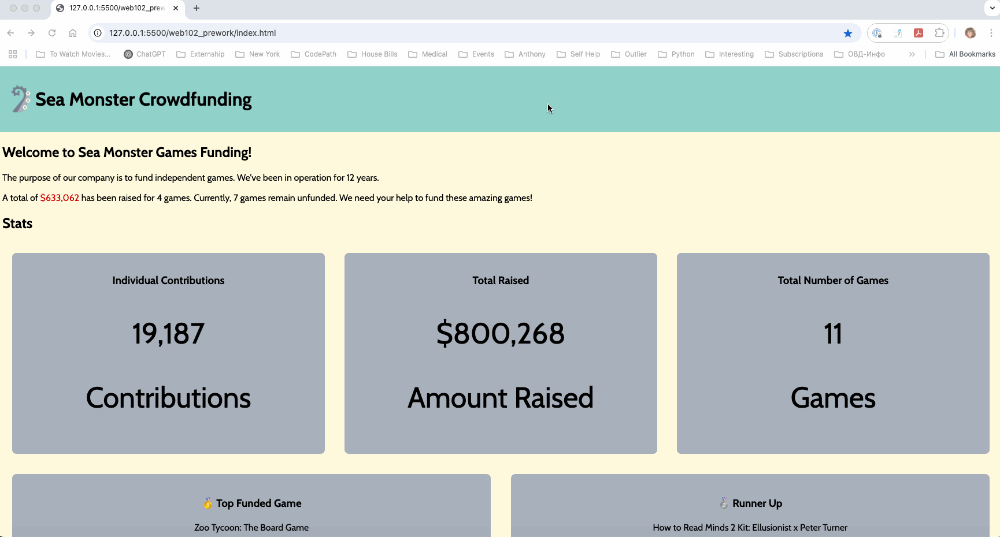

# WEB102 Prework - Sea Monster Crowdfunding

Submitted by: **Olga Sherman**

**Sea Monster Games Funding** is a website for the company Sea Monster Crowdfunding that displays information about the games they have funded.

Time spent: **~25 hours** spent in total

## Required Features

The following **required** functionality is completed:

* [x] The introduction section explains the background of the company and how many games remain unfunded.
* [x] The Stats section includes information about the total contributions and dollars raised as well as the top two most funded games.
* [x] The Our Games section initially displays all games funded by Sea Monster Crowdfunding
* [x] The Our Games section has three buttons that allow the user to display only unfunded games, only funded games, or all games.
* [x] Top 2 games are displayed using destructuring and spread
* [x] Responsive layout using Flexbox

The following **optional** features are implemented:

* [x] Games that are not funded have a red border
* [x] Games that are funded have a green border
* [x] Live search box filters games by name
* [x] Background changed from grey to light yellow, header to cyan, added footer
* [x] Total money raised displayed in red
* [x] Buttons look moving up and down when hover over and clicked

## Video Walkthrough
Here's a walkthrough of implemented features:

GIF created with **LiceCap**  

## Notes
Describe any challenges encountered while building the app.

- Took me some time to get up to speed with git
- I had to learn and debug how Flexbox css layouts worked
- Understanding reduce method, filter, destructuring, spread, arrow and other JS functions took a lot of time and practice
- At first, I forgot to use a local server, which caused CORS errors with module imports
- In Challenge #3 took me a while to figure out that tricky question where I learned that template literals require backticks ` `, not quotes
- Learned to do LICEcap, practiced a lot recording to keep time at minimum and demo key features

## License

    Copyright Olga Sherman & CodePath 2025

    Licensed under the Apache License, Version 2.0 (the "License");
    you may not use this file except in compliance with the License.
    You may obtain a copy of the License at

        http://www.apache.org/licenses/LICENSE-2.0

    Unless required by applicable law or agreed to in writing, software
    distributed under the License is distributed on an "AS IS" BASIS,
    WITHOUT WARRANTIES OR CONDITIONS OF ANY KIND, either express or implied.
    See the License for the specific language governing permissions and
    limitations under the License.
